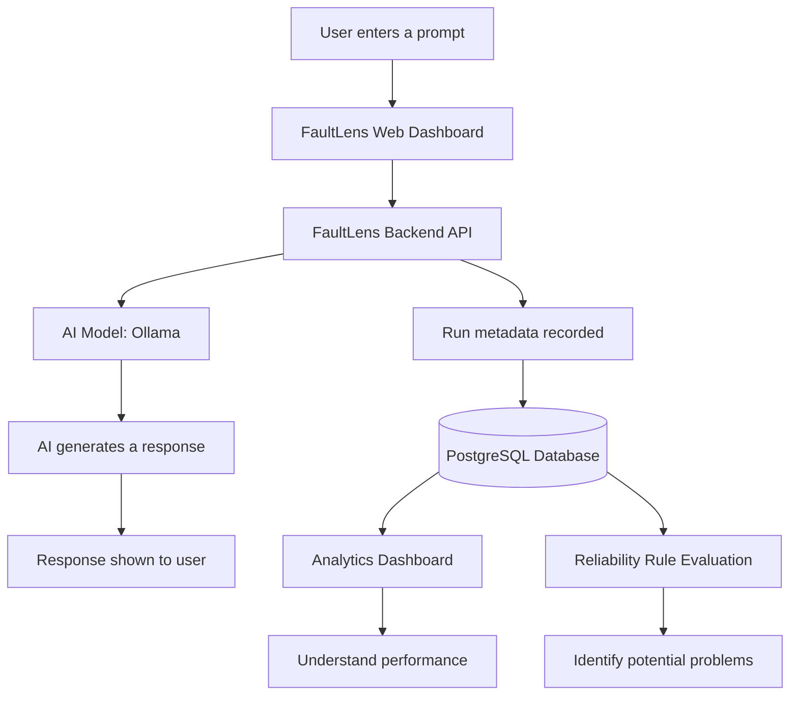
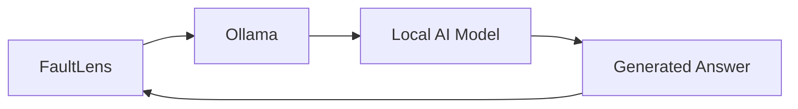

# FaultLens 🔎
### Understand, Monitor, and Improve AI Applications

FaultLens is an AI observability platform. It helps developers understand how their AI models are working, how long they take to respond, how many requests fail, and whether one prompt works better than another.

**In simple words:** FaultLens is like a health checker for AI applications.

Just as a doctor checks whether a person is healthy, FaultLens checks whether an AI application is working properly.

---

## 1. 🤔 Why Do We Need FaultLens?

Imagine you build a chatbot for a shop.

A customer asks, "Where is my order?"

Sometimes the chatbot answers correctly. Sometimes it fails. Sometimes it takes 30 seconds to respond.

Without monitoring, you might not know what went wrong.

### Problems FaultLens helps solve

| Problem | How FaultLens helps |
|---|---|
| AI requests fail | Records successful and failed requests |
| AI responds slowly | Measures response time |
| You don't know how much the AI uses | Tracks available input and output token counts |
| You don't know which prompt is better | Compares prompt versions against the same test examples |
| Failures happen repeatedly | Lets you define reliability rules to detect failure spikes |
| You need to understand model performance | Shows run history and performance analytics |

**Why is this important?**

An AI application can produce impressive answers during a demo but still fail in real use. Developers need information about its reliability and performance, not just its answers.

---

## 2. 🧒 How Does FaultLens Work?

Think of ordering food from a restaurant.

1. You place an order.
2. The restaurant prepares your food.
3. You receive your order.
4. The restaurant records how long the order took and whether anything went wrong.

FaultLens follows a similar idea, except the order is an AI request.

### Working architecture



### What does each part do?

- **Web Dashboard:** The screen where you enter prompts and view results.
- **Backend API:** Receives requests and coordinates the work.
- **Ollama:** Runs an AI model locally on your computer.
- **PostgreSQL:** Stores run metadata and other saved project data.
- **Analytics:** Summarizes performance information.
- **Reliability Rules:** Checks recorded metrics against thresholds you configure.

**Why is this architecture important?**

It separates the user interface, AI generation, data storage, and monitoring. This makes the application easier to understand, test, and improve.

---

## 3. ✨ Main Features

### Feature 1: AI Playground

Send a prompt to a local AI model and view its response.

**Example:**

Input:

```text
Explain what a REST API is in simple words.
```

The model generates an answer, and FaultLens records available information about the request, such as its duration, status, and token usage.

**Why is this important?**

You can test an actual model and observe its behavior instead of relying only on mock responses.

### Feature 2: AI Run History

Every recorded AI run represents an individual request.

The run history can show:

- Whether the request succeeded or failed.
- Which model and provider were used.
- How long the request took.
- Available token counts.
- Error information when a request fails.

**Why is this important?**

When something goes wrong, you can inspect the recorded requests instead of guessing whether the AI model worked.

Note: The current playground does not store raw prompts and responses in run history.

### Feature 3: Usage and Performance Analytics

FaultLens summarizes information from recorded AI requests.

For example:

| Metric | Example |
|---|---:|
| Total runs | 100 |
| Successful runs | 90 |
| Failed runs | 10 |
| Success rate | 90% |
| Average latency | 2 seconds |
| Known token usage | 25,000 |

These are illustrative numbers, not actual measurements from your project.

**Why is this important?**

Numbers help you identify whether your application is becoming slower or less reliable over time.

### Feature 4: Prompt Evaluation

A prompt is the instruction you give an AI model.

For example:

- Prompt A: "Answer the question."
- Prompt B: "Answer clearly, give practical steps, and avoid inventing facts."

FaultLens lets you save prompt versions and compare them using the same test dataset.

**Basic workflow:**

1. Create two prompt versions.
2. Create a dataset containing questions and expected answers.
3. Select the prompt versions.
4. Run the comparison.
5. Review the scores, latency, token usage, and generated answers when available.

**Why is this important?**

You can test whether a change to your instructions improves the results instead of choosing prompts based on guesswork.

The current score is based on case-insensitive word overlap. It does not prove factual correctness or semantic similarity, so review the answers yourself.

### Feature 5: Reliability Alerts

Reliability alerts let you create rules to identify potentially unhealthy AI request patterns.

Examples:

- Failure rate greater than or equal to 10%.
- P95 latency greater than or equal to 2,500 milliseconds.
- At least three failed requests within a selected time window.

You create a rule and click **Evaluate enabled rules** to check recorded metadata against it.

**Why is this important?**

A developer may not notice a series of failures by looking at individual requests. Rules make important patterns easier to identify.

**Current limitation:** Evaluation is on demand. Rules do not continuously run or send email, Slack, or other external notifications.

---

## 4. 🔑 Does FaultLens Need an AI API Key?

Not for its current local Ollama workflow.

Ollama runs compatible AI models on your computer, so you do not need a cloud provider API key for that workflow.



You still need to download a model and have enough system resources to run it.

For example, your current project has used models such as `qwen2.5:0.5b` and `qwen2.5:3b`.

**Why is this important?**

Local AI makes it possible to experiment without paying for cloud API requests. However, response speed and quality depend on your model and computer.

Support for OpenAI, Gemini, Anthropic, or other hosted AI providers requires separate integrations. Do not assume that any API key can be pasted into the current Ollama playground.

---

## 5. 🚀 How to Run FaultLens Locally

### Requirements

Install the following:

- Git
- Node.js, using a version compatible with the project
- pnpm
- Docker Desktop
- An internet connection for downloading dependencies and images

### Step 1: Open the project

```bash
git clone https://github.com/Kushagrarai09/FaultLens.git
cd FaultLens
```

If you already downloaded the repository, open its folder in VS Code instead.

### Step 2: Configure environment variables

Check the `.env.example` file and the project README. Create or update your `.env` file with the values required by your Docker Compose configuration.

Do not share real passwords, API keys, or other secrets.

### Step 3: Start the application

Make sure Docker Desktop is running, then execute:

```bash
docker compose up --build -d
```

This command builds the required images and starts the configured services in the background.

The first build may take time because Docker needs to download images and build the application.

### Step 4: Check the containers

```bash
docker compose ps
```

View application logs if something fails:

```bash
docker compose logs --tail=100
```

For a particular service, such as the API:

```bash
docker compose logs --tail=100 api
```

### Step 5: Open FaultLens

Open the local web address configured by your Compose file. In your current setup, you have been accessing the dashboard at:

http://localhost:3000

### Step 6: Test the application

1. Open the AI Playground.
2. Select an installed Ollama model.
3. Enter a prompt and click **Run prompt**.
4. Inspect the response and run metadata.
5. Open AI runs and Cost & Performance.
6. Try Prompt Evaluation with two prompt versions and a dataset.
7. Create a Reliability Alert rule and evaluate it.

If the model times out or returns an HTTP error, inspect the Ollama container logs and verify that the selected model is installed.

**Why is this important?**

Testing each feature in order helps you distinguish between AI generation problems, database problems, and dashboard problems.

---

## 6. 🔒 What Does FaultLens Store?

FaultLens is designed to store monitoring information without retaining raw prompts and responses in AI run history.

Its current behavior includes:

- Run metadata stored for analytics.
- Prompt templates and evaluation datasets saved for reuse.
- Generated responses returned to the browser during playground use.
- Evaluation response text scored in memory rather than persisted.

Check the implementation before relying on these behaviors for sensitive workloads.

The current MVP also lacks authentication and external alert delivery. Do not expose it publicly until proper access controls and deployment security have been implemented.

**Why is this important?**

Monitoring should help developers understand their applications without accidentally exposing sensitive user data.

---

## 7. 🛠️ What FaultLens Does Not Yet Guarantee

FaultLens is an MVP, not a fully production-ready monitoring platform.

It does not currently guarantee:

- Support for every AI provider.
- Semantic or factual evaluation of generated answers.
- Continuous background alert evaluation.
- Email or Slack notifications.
- Production-grade authentication and authorization.
- Automatic diagnosis of every model failure.

These are potential areas for future development, not features you should assume are already implemented.

---

## 8. 🎯 The Main Idea

FaultLens connects three important activities:

1. **Run AI:** Send requests to an AI model and receive answers.
2. **Observe AI:** Record performance and reliability metadata.
3. **Improve AI:** Compare prompt versions and inspect potential failures.

The main purpose is simple:

**Don't just build an AI application. Understand how it behaves, measure its performance, identify problems, and improve it using evidence.**

